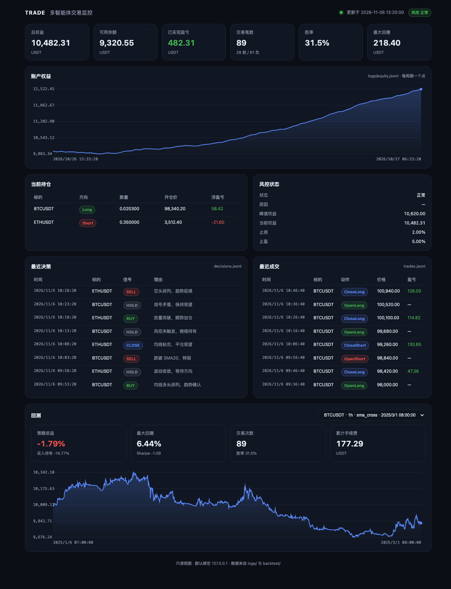

# Multi-Agent Cryptocurrency Auto Trading System

[](https://github.com/Ye-Yu-Mo/trade/actions/workflows/ci.yml)
[](LICENSE)
[](rust-toolchain.toml)

A multi-agent collaborative portfolio trading bot built with Rust, using DeepSeek LLM for decision making, and running on Binance testnet for automated cryptocurrency trading.

> This is a research and education framework, **not** a profitable trading system. See [Known Limitations](#known-limitations).

[English Version](README.md) | [中文版本](README_ZH.md)

## Core Features

- **Multi-Agent Architecture**: Market Analyst → Strategy Researcher → Risk Manager → Trade Executor → Portfolio Coordinator
- **Portfolio Management**: Support for multiple symbols with intelligent fund allocation
- **Professional Role Division**: Each agent specializes in specific domains, collaborative decision making
- **Contract Trading**: Support for long/short positions, automatic position switching
- **Technical Indicators**: SMA(5/20/50/100), Price Change Rate, ATR, Volume Ratio
- **Risk Control**: Position monitoring, P&L tracking, fund allocation, error retry
- **Deterministic Risk Layer**: stop-loss, take-profit, max drawdown and daily loss circuit breakers enforced in code, not by the LLM
- **Backtesting**: deterministic SMA baseline and an LLM baseline, with fees and slippage. No API key required for the baseline.
- **LLM Reliability**: JSON mode, request timeouts, retries, and a model-aware response cache
- **Low Call Volume**: 2 model calls per symbol per cycle (strategy + executor); risk is enforced in code

## System Architecture

### Multi-Agent Collaboration Process

```mermaid
flowchart TD
    A[main.rs<br/>Main Program] --> B[Phase 1: Parallel Market Analysis]
    A --> C[Phase 2: Portfolio Fund Allocation]
    A --> D[Phase 3: Sequential Trade Execution]
    
    B --> B1[Market Analyst<br/>market.rs]
    B --> B2[Market Analyst<br/>market.rs]
    B --> B3[Market Analyst<br/>market.rs]
    
    B1 --> E[MarketReport]
    B2 --> E
    B3 --> E
    
    E --> F[Portfolio Coordinator]
    F --> G[PortfolioAllocation]
    
    G --> H[Strategy Researcher]
    H --> I[StrategySuggestion]
    
    I --> J[Risk Manager (code)]
    J --> K[RiskAssessment]
    
    K --> L[Trade Executor<br/>executor.rs]
    L --> M[TradingDecision]
    L --> N[TradeResult]
    
    M --> O[state.rs<br/>Logging]
    N --> O
    
    subgraph "Parallel Execution"
        B1
        B2
        B3
    end
    
    subgraph "Sequential Execution"
        H
        J
        L
    end
    
    style A fill:#e1f5fe
    style B1 fill:#f3e5f5
    style B2 fill:#f3e5f5
    style B3 fill:#f3e5f5
    style F fill:#e8f5e8
    style H fill:#fff3e0
    style J fill:#ffebee
    style L fill:#e8eaf6
    style O fill:#f5f5f5
```

### Agent Role Division

1. **Market Analyst** (`market.rs`)
   - Fetch K-line data, calculate technical indicators
   - Analyze market trends, strength, phases
   - Output: `MarketReport`

2. **Strategy Researcher**
   - Develop trading strategies based on market analysis
   - Suggest target positions, stop-loss, take-profit
   - Output: `StrategySuggestion`

3. **Risk Manager** (`src/risk.rs`, deterministic)
   - Applies timing score, volatility, trend consistency, position limits and exchange constraints
   - Produces `RiskAssessment` without calling the LLM; the trade executor cannot override it

4. **Trade Executor** (`executor.rs`)
   - Make final decisions based on all inputs
   - Execute specific trading operations
   - Output: `TradingDecision`

5. **Portfolio Coordinator**
   - Manage fund allocation across multiple symbols
   - Develop portfolio strategies
   - Output: `PortfolioAllocation`

## Quick Start

### 1. Configure Environment

Copy environment template:
```bash
cp .env.example .env
```

Edit `.env` file with your information:

```bash
# Binance Testnet API (from https://testnet.binancefuture.com)
BINANCE_API_KEY=your_testnet_api_key
BINANCE_SECRET=your_testnet_secret
BINANCE_TESTNET=true

# DeepSeek API (from https://platform.deepseek.com)
DEEPSEEK_API_KEY=your_deepseek_key

# Trading Configuration
TRADE_SYMBOLS=BTCUSDT,ETHUSDT  # Multiple symbols, comma separated
TRADE_INTERVAL=1m  # Options: 1m, 15m, 30m, 1h
LEVERAGE=10  # Leverage: 1-125
MAX_POSITION=0.005  # Maximum position per symbol
PORTFOLIO_MODE=balanced  # Portfolio mode: balanced | aggressive | conservative
```

### 2. Build and Run

```bash
cargo build --release
cargo run --release
```

### 3. Check Logs

The program automatically creates `logs/` directory:

- `logs/trades.jsonl` - Trade records (open/close positions, prices, P&L)
- `logs/decisions.jsonl` - Decision records (including multi-agent analysis process)
- `logs/performance.json` - Performance tracking data

Each line is a JSON object, view with `jq`:

```bash
# View recent 10 trades
tail -10 logs/trades.jsonl | jq

# View all decisions
cat logs/decisions.jsonl | jq -c '{symbol: .symbol, signal: .decision.signal, reason: .decision.reason}'

# View performance data
cat logs/performance.json | jq
```

## Backtesting

Backtesting does **not** need a Binance API key. The deterministic SMA baseline is built in.

```bash
cargo run --release -- backtest \
  --symbol BTCUSDT \
  --interval 1h \
  --start 2025-01-01 \
  --end 2025-06-01 \
  --strategy sma
```

```text
================ 回测结果 ================
标的: BTCUSDT | 周期: 1h | 策略: sma_cross
区间: 2025-01-01 00:00 → 2025-03-01 00:00（1298 根K线）
成本: 手续费 0.050% / 单边 | 滑点 2.0 bps
-----------------------------------------
初始资金:      10000.00 USDT
最终权益:      9821.36 USDT
策略收益:      -1.79%  |  买入持有: -14.77%
最大回撤:      6.44%
Sharpe:        -1.09
交易次数:      89  |  胜率: 31.5%  |  暴露时间: 86.3%
盈亏比:        0.87
累计手续费:    177.29 USDT
=========================================
```

How it works:

- A signal is generated at bar close and filled at the **next bar's open**, so there is no look-ahead bias.
- Fees (default 5 bps per side, Binance USDT-M taker) and slippage (default 2 bps) are always applied.
- Low-confidence **entry** signals are ignored; close signals always execute.
- Stops are checked intrabar using the bar high/low, with gap fills at the bar open.
- Closing is an explicit `CLOSE` action instead of a forced reversal.
- Every run reports buy-and-hold return next to the strategy return.
- K-lines are cached in `data/klines/`; results go to `backtest/` as JSON plus equity/trade CSVs.

Key options:

| Option | Default | Meaning |
|---|---|---|
| `--strategy` | `sma` | `sma` (deterministic) or `llm` (DeepSeek) |
| `--position-pct` | `0.2` | Fraction of equity per position |
| `--leverage` | `1.0` | Kept at 1x by default to avoid fake returns |
| `--fee-bps` | `5` | Per-side fee in basis points |
| `--slippage-bps` | `2` | Per-side slippage in basis points |
| `--stop-loss-pct` | `0.02` | Intrabar stop-loss as a fraction of entry notional |
| `--take-profit-pct` | `0.05` | Intrabar take-profit as a fraction of entry notional |
| `--max-bars` | all | Limit the number of decisions (useful for `--strategy llm`) |

The LLM baseline makes one model call per bar and caches responses in `.cache/llm/`, so repeated
runs over the same range are free. Start with `--max-bars` to control cost.

Run `cargo run -- backtest --help` for the full list.

## Dashboard

A read-only monitoring UI. It never trades and binds to localhost by default:

```bash
# Standalone, reading logs/ and backtest/
cargo run --release -- dashboard --port 8080

# Or start it together with the trading loop
cargo run --release -- run --dashboard 8080
```



*Sample data from a local fixture, not real performance.*

Open http://127.0.0.1:8080 to see:

- Account equity curve (`logs/equity.jsonl`, one point per cycle)
- Current positions, risk state and halt reason
- Recent decisions and fills
- Backtest browser: return, drawdown, Sharpe, win rate and equity curve

All endpoints are read-only GETs:

```
/api/status  /api/performance  /api/risk
/api/trades  /api/decisions    /api/equity
/api/backtests  /api/backtest?file=...
```

There is no authentication. **Do not bind it to `0.0.0.0` on a public network.**

## Walk-Forward Backtesting

A single-range backtest overfits. Walk-forward picks parameters on a rolling training window and
evaluates them only on the next unseen window:

```bash
cargo run --release -- walkforward \
  --symbols BTCUSDT,ETHUSDT --interval 1h \
  --start 2025-01-01 --end 2025-06-01 \
  --train-bars 720 --test-bars 240 \
  --fast 5,10,20 --slow 20,50,100
```

```text
================ Walk-forward 结果 ================
训练 720 根 / 测试 240 根 | fast=[5, 10, 20] slow=[20, 50, 100] | 成本 0.050% + 2.0bps
---------------------------------------------------
标的              OOS收益      买入持有      最大回撤   Sharpe      交易      胜率
BTCUSDT        -6.45%   +11.49%     7.52%    -2.22     166   33.1%
ETHUSDT        -8.39%    -5.77%     8.83%    -1.77     256   33.6%
---------------------------------------------------
组合(等权)         -7.42%    +2.86%     7.54%    -2.28     422   33.4%
窗口数: 11 | 组合期末权益: 9258.09 USDT
===================================================
```

How it works:

- Each window trains on `train-bars` and is scored on the following `test-bars`, then rolls forward
  by `test-bars`.
- The training pass tries every valid `fast < slow` pair and picks the best by
  `return - 0.5 × drawdown`.
- The chosen pair is evaluated once on the test window; only out-of-sample equity is chained.
- Multiple symbols run independently with equal initial capital; the portfolio row is the sum.
- Reports go to `backtest/walkforward_<timestamp>.json` plus a portfolio equity CSV.

This is deliberately a **hard** benchmark. A simple SMA rule losing to buy-and-hold out-of-sample is
a valid and useful result.

## Multi-Agent Decision Process

### Phase 1: Parallel Market Analysis

Each symbol executes in parallel:
1. **Fetch K-line Data**: 120 K-lines, calculate technical indicators
2. **Market Analyst Decision**: Analyze trends, strength, market phases
3. **Position Query**: Get current position status

### Phase 2: Portfolio Fund Allocation

1. **Portfolio Coordinator Allocation**: Allocate funds based on symbol analysis results
2. **Strategy Development**: Choose portfolio strategy based on configuration
   - `balanced`: Balanced allocation, moderate risk
   - `aggressive`: Concentrate on best symbols, pursue high returns
   - `conservative`: Diversified investment, control risk

### Phase 3: Sequential Trade Execution

Execute sequentially for each symbol:
1. **Strategy Researcher Suggestion**: Develop specific strategies based on market conditions
2. **Risk Manager Assessment**: Approve strategies, calculate suggested quantities
3. **Trade Executor Execution**: Make comprehensive decisions, execute trades

## Technical Indicators

System calculates the following technical indicators:

- **Moving Averages**: SMA5, SMA20, SMA50, SMA100
- **Price Change Rate**: 1-period, 3-period, 6-period, 12-period
- **ATR Indicator**: 14-period Average True Range
- **Volume Ratio**: Current volume / Average volume

## Risk Control

### Multi-layer Risk Protection

1. **Agent Collaboration**: Each decision reviewed by multiple professional roles
2. **Fund Allocation**: Portfolio coordinator allocates funds reasonably
3. **Trading Constraints**: Adhere to exchange minimum order quantity, minimum notional value rules
4. **Position Limits**: Maximum position control per symbol
5. **Error Handling**: Single failure doesn't affect overall operation

### Portfolio Strategies

- **Balanced Mode**: Equally allocate based on analysis quality
- **Aggressive Mode**: Concentrate funds on most promising symbols
- **Conservative Mode**: Strictly control single symbol risk exposure

## Risk Controls and Close Semantics

### CLOSE vs SELL

| Current position | BUY | SELL | CLOSE |
|---|---|---|---|
| Flat | open long | open short | no-op |
| Long | add | close long, open short | close to flat |
| Short | close short, open long | add | close to flat |

### Deterministic risk layer

- **Stop-loss / take-profit**: default 2% / 5% of entry notional. When hit, the position is closed
  by code without calling the LLM.
- **Exchange conditional orders**: while a position is open, the bot keeps `STOP_MARKET` /
  `TAKE_PROFIT_MARKET` orders (`closePosition=true`) on Binance, triggering intrabar. Existing orders
  are reused when the trigger price still matches.
- **Circuit breakers**: new positions are blocked when equity draws down 20% from its peak or loses
  5% in a day. Existing positions are force-closed by default.
- **Persisted state**: `logs/risk_state.json`. A daily-loss halt clears on the next UTC day; a
  drawdown halt requires deleting the file and restarting.
- **Configuration**: `RISK_ENABLED`, `RISK_STOP_LOSS_PCT`, `RISK_TAKE_PROFIT_PCT`,
  `RISK_MAX_DRAWDOWN_PCT`, `RISK_DAILY_LOSS_PCT`, `RISK_CLOSE_ON_HALT`, `RISK_EXCHANGE_STOPS`,
  `RISK_TRIGGER_TYPE`.

Live trading has two layers: a per-cycle local check and exchange-side conditional orders. Conditional
orders can still slip in extreme gaps, and if placing one fails the local check is the only fallback.

## Known Limitations

These are real, and they matter more than the feature list:

1. **The backtest is simplified.** It ignores funding rates, margin liquidation, order-book impact
   and partial fills. Intrabar stops are inferred from bar high/low; the true order inside a bar is
   unknowable. Entries fill at the next bar open with fixed slippage.
2. **Conditional orders are not a guarantee.** They fill at the mark/last price against available
   liquidity and can slip in extreme gaps; if placement fails, only the per-cycle local check remains.
3. **LLM decisions are non-deterministic.** The same bar can produce different signals. The cache
   avoids repeated charges, not variance. Measure a strategy over many runs before believing it.
4. **No edge is claimed.** A naive SMA baseline and an LLM baseline are both included precisely so
   results can be compared honestly.
5. **Halts need a human.** A drawdown halt does not auto-reset; delete `logs/risk_state.json` after
   verifying the account, then restart.

## Risk Warning

⚠️ **Important Warnings**:

1. **For Learning and Research Only**: This project is for technical validation, not investment advice
2. **Testnet First**: Strongly recommend running on Binance testnet for several weeks first
3. **Fund Management**: Even on testnet, set reasonable trading parameters
4. **Monitor Operation**: Regularly check logs, observe decision quality
5. **LLM Limitations**: Large language models are not crystal balls, cannot predict the future

## FAQ

### How to Get Binance Testnet API?

**Important Update**: Binance testnet has migrated to Demo platform

1. Visit https://demo.binance.com
2. Login with GitHub or Google account (or register new account)
3. Go to Futures trading page
4. Click top-right avatar → API Management
5. Create new API Key (automatically get test funds)
6. Copy API Key and Secret to `.env` file

**Note**:
- Testnet REST API address: `https://testnet.binancefuture.com`
- Demo platform automatically provides virtual USDT for testing
- Testnet data syncs with mainnet in real-time, but trades don't affect real funds

### How to Get DeepSeek API?

1. Visit https://platform.deepseek.com
2. Register account and top up (first time gets free credits)
3. Create API key in API Keys page

### Program Error: `Missing BINANCE_API_KEY`

Check if `.env` file exists and is correctly configured.

### Program Error: `Failed to fetch K-line data`

1. Check network connection
2. Confirm Binance testnet is accessible
3. Check if rate limited (retry later)

### How to Modify Trading Interval?

Edit `TRADE_INTERVAL` in `.env` file:
- `1m` - 1 minute
- `15m` - 15 minutes
- `30m` - 30 minutes
- `1h` - 1 hour

### How to Add More Trading Pairs?

Edit `TRADE_SYMBOLS` in `.env` file, separate multiple pairs with commas:
```bash
TRADE_SYMBOLS=BTCUSDT,ETHUSDT,SOLUSDT,ADAUSDT
```

## Project Layout

```
src/
├── main.rs          Live / testnet trading loop and portfolio coordination
├── cli.rs           Command line interface (clap)
├── dashboard.rs     Read-only monitoring server (axum)
├── dashboard.html   Single-page dashboard (no build step)
├── backtest.rs      Paper broker, backtest engine, metrics
├── walkforward.rs   Rolling train/test evaluation and portfolio aggregation
├── strategy.rs      Pluggable strategies: SMA cross, LLM baseline
├── risk.rs          Deterministic stops, circuit breakers, risk state
├── data.rs          Historical K-line download and local cache
├── llm_client.rs    DeepSeek client, response cache, JSON parsing
├── multi_agent.rs   Analyst / strategist / risk manager / executor / coordinator
├── executor.rs      Binance USDT-M REST + account WebSocket
├── market.rs        K-line fetching and technical indicators
├── types.rs         Core data structures
├── state.rs         Trade and decision logs
├── performance.rs   Realized P&L and drawdown tracking
└── logging.rs       Logging setup
```

## Tech Stack

- **Rust** 1.83+ (edition 2021)
- **async-openai** - DeepSeek API client
- **reqwest** - HTTP requests
- **tokio** - Async runtime
- **serde/serde_json** - JSON serialization
- **hmac/sha2** - Binance API signing
- **anyhow** - Error handling
- **chrono** - Time handling
- **futures** - Async programming
- **log/flexi_logger** - Logging system

## License

MIT — see [LICENSE](LICENSE).
