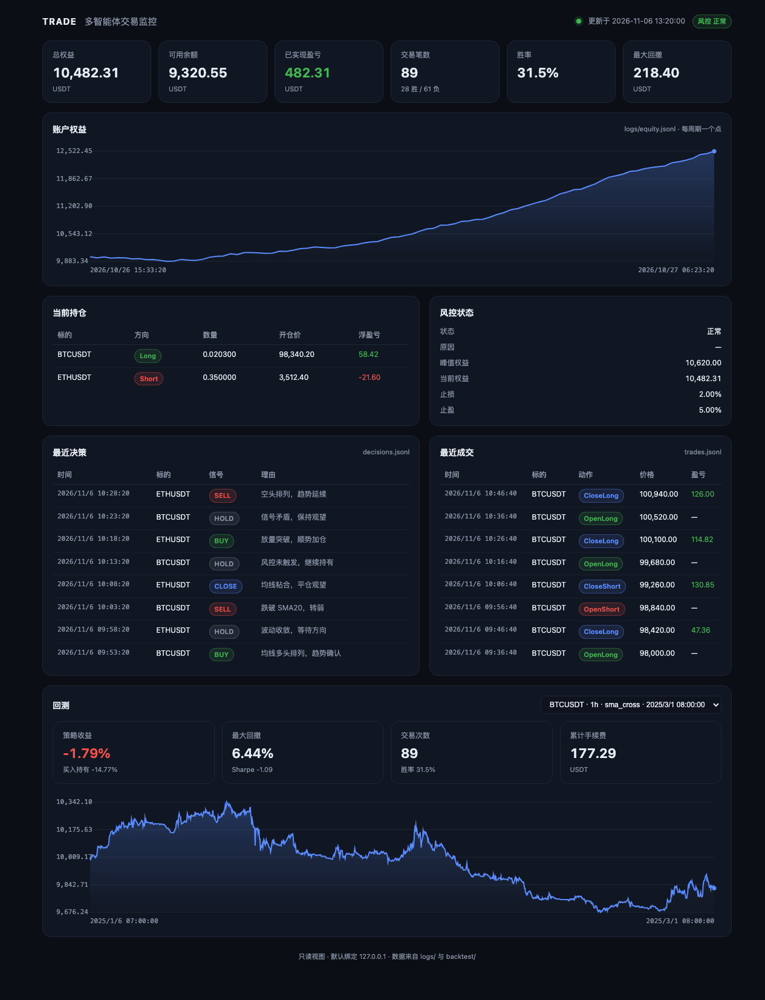
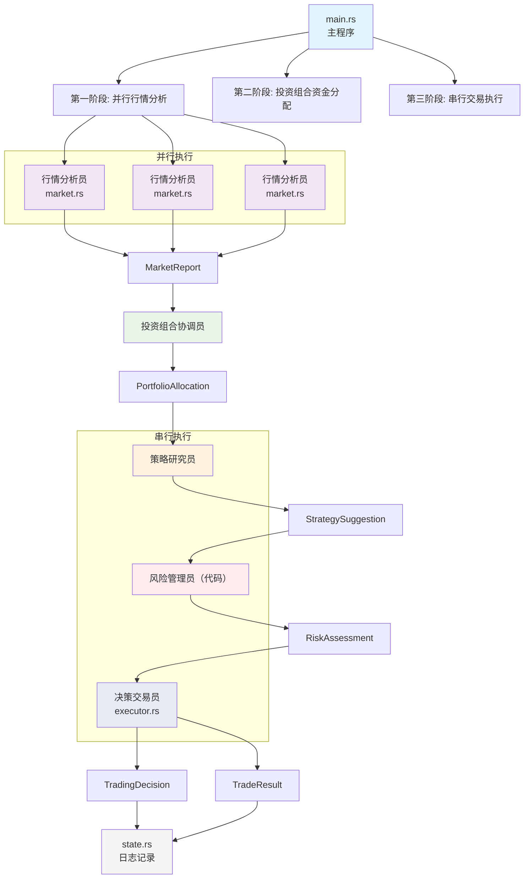

# 多智能体加密货币自动交易系统

[](https://github.com/Ye-Yu-Mo/trade/actions/workflows/ci.yml)
[](LICENSE)
[](rust-toolchain.toml)

基于 DeepSeek 的多智能体协作投资组合交易机器人，使用 Rust 实现，在 Binance 测试网上对多个加密货币进行自动交易。

> 这是一个研究与教学框架，**不是**能稳定盈利的交易系统。请先读[已知限制](#已知限制)。

## 60 秒试跑

不需要 API key，不需要联网，不需要配置。

```bash
cargo run --release -- demo
```

用仓库自带的 BTCUSDT 1h 样本跑一次 SMA 回测，把结果写进 Dashboard，并启动在 http://127.0.0.1:8080。
**Agent 决策流**面板会展示一段真实 DeepSeek 运行记录下来的多智能体决策链。



*示例数据与录制回放，非真实收益。*

[English Version](README.md) | [中文版本](README_ZH.md)

## 核心特性

- **多智能体架构**：行情分析员 → 策略研究员 → 风险管理员 → 决策交易员 → 投资组合协调员
- **投资组合管理**：支持多标的并行交易，智能资金分配
- **专业角色分工**：每个智能体专注特定领域，协同决策
- **合约交易**：支持做多/做空，自动处理多空切换
- **技术指标**：SMA(5/20/50/100)、价格变化率、ATR、成交量比
- **风险控制**：持仓监控、盈亏跟踪、资金分配、错误重试
- **确定性风控**：止损/止盈、最大回撤与日内亏损熔断，由代码强制执行，不依赖 LLM
- **历史回测**：确定性 SMA 基线与 LLM 基线，内置手续费和滑点，基线策略无需任何 API key
- **策略基准**：SMA walk-forward / 随机 / LLM / 买入持有，同窗口同成本，输出 Markdown 排行榜
- **LLM 可靠性**：JSON 模式、超时重试、按模型区分的响应缓存
- **低调用量**：每个标的每轮 2 次模型调用（策略 + 交易员），风控由代码完成
- **Agent 决策链**：每一步记录模型、耗时、token 消耗和完整 JSON 输出，Dashboard 可直接查看

## 系统架构

### 多智能体协作流程



### 智能体角色分工

1. **行情分析员** (`market.rs`)
   - 获取K线数据，计算技术指标
   - 分析市场趋势、强度、阶段
   - 输出：`MarketReport`

2. **策略研究员**
   - 基于行情分析制定交易策略
   - 建议目标仓位、止损止盈
   - 输出：`StrategySuggestion`

3. **风险管理员**（`src/risk.rs`，确定性代码）
   - 按时机评分、波动率、趋势一致性、仓位上限和交易所约束评估
   - 输出 `RiskAssessment`，不调用 LLM；交易员不能覆盖其结论

4. **决策交易员** (`executor.rs`)
   - 综合各方意见做出最终决策
   - 执行具体交易操作
   - 输出：`TradingDecision`

5. **投资组合协调员**
   - 管理多标的资金分配
   - 制定投资组合策略
   - 输出：`PortfolioAllocation`

## 快速开始

### 1. 配置环境

复制环境变量模板：
```bash
cp .env.example .env
```

编辑 `.env` 文件，填入以下信息：

```bash
# Binance 测试网 API (从 https://testnet.binancefuture.com 获取)
BINANCE_API_KEY=your_testnet_api_key
BINANCE_SECRET=your_testnet_secret
BINANCE_TESTNET=true

# DeepSeek API (从 https://platform.deepseek.com 获取)
DEEPSEEK_API_KEY=your_deepseek_key

# 交易配置
TRADE_SYMBOLS=BTCUSDT,ETHUSDT  # 多标的交易，逗号分隔
TRADE_INTERVAL=1m  # 可选: 1m, 15m, 30m, 1h
LEVERAGE=10  # 杠杆倍数: 1-125
MAX_POSITION=0.005  # 每个标的最大持仓量
PORTFOLIO_MODE=balanced  # 投资组合模式: balanced(均衡) | aggressive(激进) | conservative(保守)
```

### 2. 编译运行

```bash
cargo build --release
cargo run --release
```

### 3. 查看日志

程序会自动创建 `logs/` 目录：

- `logs/trades.jsonl` - 交易记录（开仓/平仓/价格/盈亏）
- `logs/decisions.jsonl` - 决策记录（包含多智能体分析过程）
- `logs/performance.json` - 性能跟踪数据

每行一个 JSON 对象，可用 `jq` 查看：

```bash
# 查看最近10条交易
tail -10 logs/trades.jsonl | jq

# 查看所有决策
cat logs/decisions.jsonl | jq -c '{symbol: .symbol, signal: .decision.signal, reason: .decision.reason}'

# 查看性能数据
cat logs/performance.json | jq
```

## 历史回测

回测**不需要 Binance API key**，内置的确定性 SMA 基线可以直接跑。

```bash
cargo run --release -- backtest \
  --symbol BTCUSDT \
  --interval 1h \
  --start 2025-01-01 \
  --end 2025-06-01 \
  --strategy sma
```

```text
================ 回测结果 ================
标的: BTCUSDT | 周期: 1h | 策略: sma_cross
区间: 2025-01-01 00:00 → 2025-03-01 00:00（1298 根K线）
成本: 手续费 0.050% / 单边 | 滑点 2.0 bps
-----------------------------------------
初始资金:      10000.00 USDT
最终权益:      9821.36 USDT
策略收益:      -1.79%  |  买入持有: -14.77%
最大回撤:      6.44%
Sharpe:        -1.09
交易次数:      89  |  胜率: 31.5%  |  暴露时间: 86.3%
盈亏比:        0.87
累计手续费:    177.29 USDT
=========================================
```

设计要点：

- 信号在K线收盘时产生，在**下一根K线开盘**成交，避免未来函数
- 手续费（默认单边 5 bps，Binance U 本位 taker）和滑点（默认 2 bps）始终计入
- 低信心的**入场**信号忽略；平仓信号始终执行
- 止损止盈用K线高低点判断盘中触发，跳空按开盘价成交，避免只用收盘价低估风险
- 平仓是独立动作 `CLOSE`，不强制反手
- 每次回测都会同时给出策略收益和买入持有收益，便于对照
- K线缓存在 `data/klines/`，结果写入 `backtest/`（JSON + 权益曲线/成交明细 CSV）

常用参数：

| 参数 | 默认值 | 含义 |
|---|---|---|
| `--strategy` | `sma` | `sma`（确定性基线）或 `llm`（DeepSeek） |
| `--position-pct` | `0.2` | 每次开仓占当前权益的比例 |
| `--leverage` | `1.0` | 默认 1 倍，避免回测制造虚假收益 |
| `--fee-bps` | `5` | 单边手续费（bps） |
| `--slippage-bps` | `2` | 单边滑点（bps） |
| `--stop-loss-pct` | `0.02` | 盘中浮亏达到开仓名义价值的该比例时止损 |
| `--take-profit-pct` | `0.05` | 盘中浮盈达到该比例时止盈 |
| `--max-bars` | 全部 | 限制决策次数（`--strategy llm` 建议配合使用） |

LLM 基线每根K线调用一次模型，响应缓存在 `.cache/llm/`，同一区间重复回测不再产生费用。
建议先用 `--max-bars` 控制规模。

完整参数见 `cargo run -- backtest --help`。

## Dashboard

只读监控面板，不参与交易，默认只监听本机：

```bash
# 单独启动，读取 logs/ 与 backtest/
cargo run --release -- dashboard --port 8080

# 或者随交易循环一起启动
cargo run --release -- run --dashboard 8080
```

打开 http://127.0.0.1:8080 可以看到：

- 账户权益曲线（`logs/equity.jsonl`，每周期一个点）
- 当前持仓、风控状态与熔断原因
- 最近决策与成交
- 回测结果浏览：收益、回撤、Sharpe、胜率，以及权益曲线

接口全部是只读 GET：

```
/api/status  /api/performance  /api/risk
/api/trades  /api/decisions    /api/equity
/api/backtests  /api/backtest?file=...
```

没有鉴权，**不要把 `--host` 改成 0.0.0.0 暴露到公网**。

## 策略基准

同区间、同成本、同一套 walk-forward 窗口，比较四种策略。这是项目保持诚实的部分：

```bash
cargo run --release -- benchmark \
  --symbols BTCUSDT,ETHUSDT --interval 1h \
  --start 2025-01-01 --end 2025-06-01
```

BTCUSDT + ETHUSDT，1h，训练 720 / 测试 240，手续费 5bps + 滑点 2bps，随机种子 42：

| Strategy | Portfolio | Buy & hold | Max DD | Sharpe | Trades | Win rate | Fees |
|---|---:|---:|---:|---:|---:|---:|---:|
| SMA walk-forward | -7.42% | +2.86% | 7.54% | -2.28 | 422 | 33.4% | 404.31 |
| Random (p=0.05) | +0.17% | +2.86% | 4.18% | 0.11 | 213 | 41.8% | 213.36 |
| Buy & hold | +2.76% | +2.76% | 37.38% | 0.48 | 0 | — | 10.00 |

样本外，SMA 规则跑输了抛硬币；买入持有收益更高，但最大回撤 37%。
`--strategies` 也支持 `llm`（每个测试 bar 一次模型调用，需要 `DEEPSEEK_API_KEY`）。

结果会以 Markdown 和 JSON 写入 `backtest/`。

## Agent 决策链

`trade analyze` 会跑一次完整决策链，但不下单：

```bash
cargo run --release -- analyze --symbol BTCUSDT --interval 1h
```

每一步写入 `logs/agent_trace.jsonl`：

- 阶段：`market_analyst` / `strategy_researcher` / `risk_manager` / `trade_executor`
- 模型、是否命中缓存、耗时
- prompt / completion token 数
- 完整 JSON 输出

Dashboard 会把它渲染成时间线。用它调试 prompt、对比模型，或者看清一个决策到底怎么来的。
`analyze` 需要 `DEEPSEEK_API_KEY`；`demo` 用的是仓库内录制好的示例，不需要 key。

## Walk-forward 样本外回测

单区间回测很容易过拟合。Walk-forward 在滚动训练窗口里选参数，然后只在下一段没见过的数据上评估：

```bash
cargo run --release -- walkforward \
  --symbols BTCUSDT,ETHUSDT --interval 1h \
  --start 2025-01-01 --end 2025-06-01 \
  --train-bars 720 --test-bars 240 \
  --fast 5,10,20 --slow 20,50,100
```

```text
================ Walk-forward 结果 ================
训练 720 根 / 测试 240 根 | fast=[5, 10, 20] slow=[20, 50, 100] | 成本 0.050% + 2.0bps
---------------------------------------------------
标的              OOS收益      买入持有      最大回撤   Sharpe      交易      胜率
BTCUSDT        -6.45%   +11.49%     7.52%    -2.22     166   33.1%
ETHUSDT        -8.39%    -5.77%     8.83%    -1.77     256   33.6%
---------------------------------------------------
组合(等权)         -7.42%    +2.86%     7.54%    -2.28     422   33.4%
窗口数: 11 | 组合期末权益: 9258.09 USDT
===================================================
```

规则：

- 每个窗口用 `train-bars` 训练，紧接的 `test-bars` 测试，然后按 `test-bars` 向前滚动
- 训练段遍历所有合法的 `fast < slow` 组合，按 `收益 - 0.5 × 回撤` 选一组
- 选出的参数只在测试窗口跑一次，只有样本外权益会被链接起来
- 多标的按等权分配初始资金，组合行是各标的的加总
- 报告写入 `backtest/walkforward_<时间戳>.json` 和组合权益 CSV

这是刻意设置的**严格**基准。一个简单的 SMA 规则在样本外跑输买入持有，是一个有效且有用的结论。

## 多智能体决策流程

### 第一阶段：并行行情分析

每个标的并行执行：
1. **获取K线数据**：120根K线，计算技术指标
2. **行情分析员决策**：分析趋势、强度、市场阶段
3. **持仓查询**：获取当前持仓状态

### 第二阶段：投资组合资金分配

1. **组合协调员分配**：基于各标的分析结果分配资金
2. **策略制定**：根据配置选择投资组合策略
   - `balanced`：均衡分配，风险适中
   - `aggressive`：集中优势标的，追求高收益
   - `conservative`：分散投资，控制风险

### 第三阶段：串行交易执行

对每个标的顺序执行：
1. **策略研究员建议**：基于行情制定具体策略
2. **风险管理员评估**：审批策略，计算建议数量
3. **决策交易员执行**：综合决策，执行交易

## 技术指标

系统计算以下技术指标：

- **移动平均线**：SMA5、SMA20、SMA50、SMA100
- **价格变化率**：1周期、3周期、6周期、12周期
- **ATR指标**：14周期平均真实波幅
- **成交量比**：当前成交量/平均成交量

## 风险控制

### 多层风险防护

1. **智能体协作**：每个决策经过多个专业角色审核
2. **资金分配**：投资组合协调员合理分配资金
3. **交易约束**：遵守交易所最小下单量、最小名义价值等规则
4. **持仓限制**：每个标的最大持仓量控制
5. **错误处理**：单次失败不影响整体运行

### 投资组合策略

- **均衡模式**：各标的按分析质量均衡分配
- **激进模式**：集中资金到最有潜力的标的
- **保守模式**：严格控制单标的风险敞口

## 风控与平仓语义

### CLOSE 与 SELL 的区别

| 当前持仓 | BUY | SELL | CLOSE |
|---|---|---|---|
| 空仓 | 开多 | 开空 | 无操作 |
| 多仓 | 加仓 | 平多并开空 | 平多到空仓 |
| 空头 | 平空并开多 | 加仓 | 平空到空仓 |

第三行指持有空头的情况：BUY 反手，SELL 加仓。

### 确定性风控（代码层）

- **止损 / 止盈**：默认分别为开仓名义价值的 2% / 5%。触发时跳过 LLM，直接平仓。
- **交易所条件单**：有仓位时自动挂 `STOP_MARKET` / `TAKE_PROFIT_MARKET`（`closePosition=true`），由交易所在盘中触发；已有且价格一致则复用。
- **熔断**：权益从峰值回撤 20%，或当日亏损 5% 时停止开仓；默认同时强制平掉现有仓位。
- **状态持久化**：写入 `logs/risk_state.json`。日内亏损熔断在 UTC 次日自动解除；回撤熔断需要人工删除该文件后重启。
- **可配置**：`RISK_ENABLED`、`RISK_STOP_LOSS_PCT`、`RISK_TAKE_PROFIT_PCT`、`RISK_MAX_DRAWDOWN_PCT`、`RISK_DAILY_LOSS_PCT`、`RISK_CLOSE_ON_HALT`、`RISK_EXCHANGE_STOPS`、`RISK_TRIGGER_TYPE`。

实盘同时有本地周期检查和交易所条件单两层；条件单下单失败或极端跳空时仍可能滑价。

## 已知限制

以下问题比功能列表更值得先看：

1. **回测是简化模型。** 不模拟资金费率、保证金强平、盘口冲击和部分成交。盘中止损按K线高低点估算，同一根K线内的真实成交顺序无法还原。
2. **条件单不是万能的。** 交易所触发按标记价/最新价以及当时流动性成交，极端行情仍会滑价；条件单下单失败时只剩本地周期检查。
3. **LLM 决策不确定。** 同一根K线可能给出不同信号。缓存只避免重复付费，不能消除方差，请多跑几次再判断策略。
4. **不宣称有超额收益。** 同时提供朴素的 SMA 基线和 LLM 基线，就是为了让结果可以被诚实地对照。
5. **熔断需要人工介入。** 回撤熔断不会自动恢复，必须确认账户状态后删除 `logs/risk_state.json` 再重启。

## 风险提示

⚠️ **重要警告**：

1. **仅供学习研究**：本项目用于技术验证，不构成投资建议
2. **测试网优先**：强烈建议先在 Binance 测试网运行数周
3. **资金管理**：即使测试网，也应设置合理的交易参数
4. **监控运行**：定期检查日志，观察决策质量
5. **LLM 局限性**：大语言模型不是水晶球，无法预测未来

## 常见问题

### 如何获取 Binance 测试网 API？

**重要更新**：Binance 测试网已迁移到 Demo 平台

1. 访问 https://demo.binance.com
2. 使用 GitHub 或 Google 账号登录（或注册新账号）
3. 进入 Futures 交易页面
4. 点击右上角头像 → API Management
5. 创建新的 API Key（自动获得测试资金）
6. 复制 API Key 和 Secret 到 `.env` 文件

**注意**：
- 测试网 REST API 地址：`https://testnet.binancefuture.com`
- Demo 平台会自动提供虚拟 USDT 用于测试
- 测试网数据与主网实时同步，但交易不影响真实资金

### 如何获取 DeepSeek API？

1. 访问 https://platform.deepseek.com
2. 注册账号并充值（首次赠送免费额度）
3. 在 API Keys 页面创建密钥

### 程序报错：`缺少 BINANCE_API_KEY`

检查 `.env` 文件是否存在且正确配置。

### 程序报错：`获取K线数据失败`

1. 检查网络连接
2. 确认 Binance 测试网是否可访问
3. 查看是否被限流（稍后重试）

### 如何修改交易周期？

编辑 `.env` 文件中的 `TRADE_INTERVAL`：
- `1m` - 1分钟
- `15m` - 15分钟
- `30m` - 30分钟
- `1h` - 1小时

### 如何添加更多交易对？

编辑 `.env` 文件中的 `TRADE_SYMBOLS`，用逗号分隔多个交易对：
```bash
TRADE_SYMBOLS=BTCUSDT,ETHUSDT,SOLUSDT,ADAUSDT
```

## 项目结构

```
src/
├── main.rs          实盘 / 测试网交易循环与投资组合协调
├── cli.rs           命令行入口（clap）
├── demo.rs          离线零依赖 Demo 与日志生成
├── analyze.rs       单次多智能体决策链（dry-run）
├── dashboard.rs     只读监控服务（axum）
├── dashboard.html   Dashboard 单页（无构建步骤）
├── backtest.rs      纸面账户、回测引擎、绩效指标
├── walkforward.rs   滚动训练/测试评估与组合聚合
├── benchmark.rs     策略排行榜与 Markdown 渲染
├── strategy.rs      可插拔策略：SMA 交叉、LLM 基线
├── risk.rs          确定性风控：止损止盈、熔断、风控状态
├── data.rs          历史K线下载与本地缓存
├── llm_client.rs    DeepSeek 客户端、响应缓存、JSON 解析
├── multi_agent.rs   分析员 / 策略 / 风控 / 交易员 / 组合协调员
├── executor.rs      Binance U 本位 REST + 账户 WebSocket
├── market.rs        K线获取与技术指标
├── types.rs         核心数据结构
├── state.rs         交易与决策日志
├── performance.rs   已实现盈亏与回撤跟踪
└── logging.rs       日志系统
examples/
├── BTCUSDT_1h_sample.json    内置 90 天K线样本
└── agent_trace.sample.jsonl  录制好的多智能体决策链
```

## 技术栈

- **Rust** 1.83+ (edition 2021)
- **async-openai** - DeepSeek API 客户端
- **reqwest** - HTTP 请求
- **tokio** - 异步运行时
- **serde/serde_json** - JSON 序列化
- **hmac/sha2** - Binance API 签名
- **anyhow** - 错误处理
- **chrono** - 时间处理
- **futures** - 异步编程
- **log/flexi_logger** - 日志系统

## License

MIT，详见 [LICENSE](LICENSE)。
